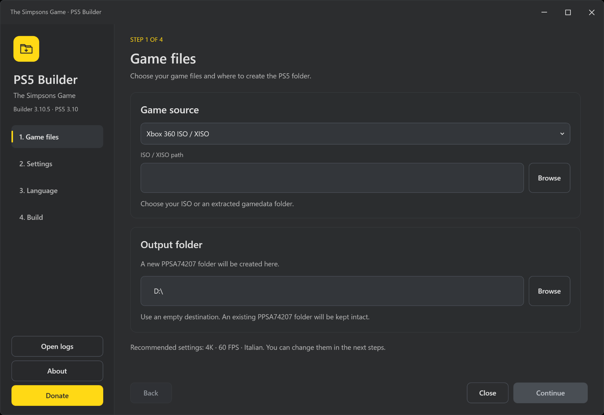
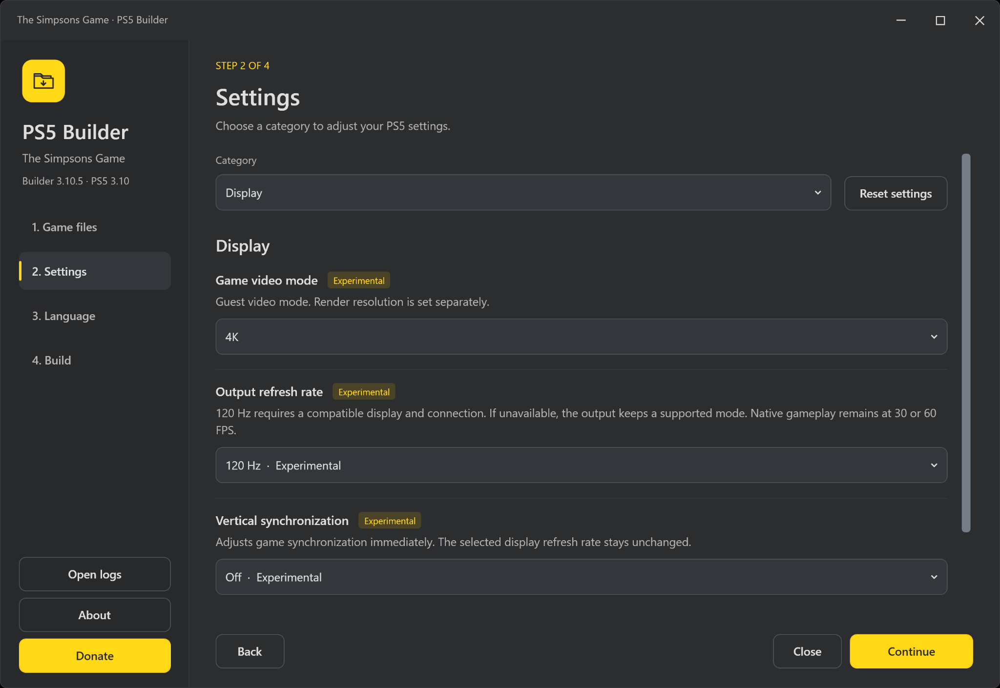
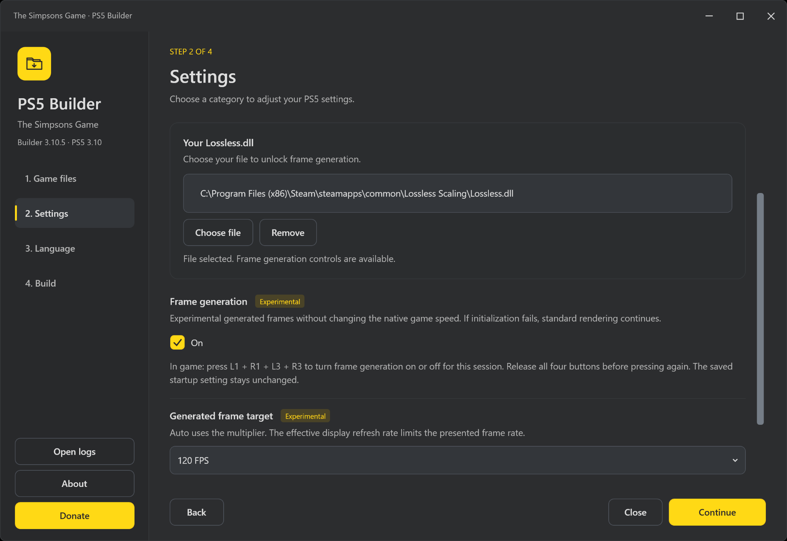

# TheSimpsonsGame-PS5-Builder

Build **The Simpsons Game** for PS5 from your own Xbox 360 ISO/XISO or extracted
game files. Choose your graphics and language settings, then create a complete
**PPSA74207** folder ready to transfer to your console.

Maintained by **LoZazaMastro**.
**[Download](https://github.com/LoZazaMastro/TheSimpsonsGame-PS5-Builder/releases/latest)** ·
[Changelog](CHANGELOG.md) ·
[Builder guide](prospero/builder/README.md) ·
**[Donate](https://ko-fi.com/lozazamastro)**

The builder has an English WPF interface with a resizable dark window, yellow
controls and Windows Acrylic. **TheSimpsonsGame-PS5-Builder.exe** includes its
.NET runtime, so you can run it without installing an SDK or a separate
extractor. English is the default game language; you can select another
language available on your disc.

## Screenshots

### Game files

Choose your ISO/XISO or extracted game folder and the output location.



### Display settings

Set the game video mode, output refresh rate and VSync. Experimental options
are marked in the interface.



### Frame generation

Select your own **Lossless.dll** to unlock frame generation. The shortcut hint
shows how to turn it on or off during play.



## What you need

- Windows 11 x64.
- Your own Xbox 360 copy of **The Simpsons Game**, dumped as an ISO/XISO, or an
  extracted folder containing **default.xex**, **movies** and the rest of the
  game files.
- Enough free space for the extracted game and the new PS5 folder.
- A PS5 homebrew setup that supports native titles, using
  [ShadowMountPlus](https://github.com/drakmor/shadowMountPlus).
- Your own **Lossless.dll** from
  [Lossless Scaling](https://store.steampowered.com/app/993090/Lossless_Scaling/)
  if you want to use frame generation.

Regional Xbox 360 editions share **Title ID 45410809**. The builder accepts
that title without a Media ID or region whitelist. Available languages depend
on the files included on your disc.

Game files and **Lossless.dll** are not included in the download.

## Create your PS5 folder

1. Open **TheSimpsonsGame-PS5-Builder.exe**.
2. Select your ISO/XISO or extracted game folder.
3. Choose the output location. The builder creates **PPSA74207** inside it.
4. Review the settings and choose a game language.
5. For frame generation, select your **Lossless.dll** and choose its settings.
6. Open **Build**, review the summary and start the build.
7. Transfer the completed folder to **/data/homebrew/PPSA74207** and mount it
   with ShadowMountPlus.

Your source files remain unchanged. If the output already contains a
**PPSA74207** folder, choose another location. Build progress and any errors
are recorded in **Open logs**.

### Files and updates

| Path inside PPSA74207 | Contents |
| --- | --- |
| eboot.bin | PS5 executable |
| sce_sys/ | Title metadata, icon, backgrounds and Home music |
| sce_module/ | Runtime module |
| gamedata/ | Extracted Xbox 360 game files |
| userdata/simpsons.toml | Game settings |
| userdata/lossless/Lossless.dll | Optional frame-generation file |
| userdata/ | Settings, saves and other user data |
| logs/ and cache/ | Game logs and cache |

Keep **gamedata** and **userdata** when updating an existing installation.
To apply settings from a new builder output, copy its **userdata/simpsons.toml**
to the existing title's writable **userdata** folder. Keep the other files and
saves in that folder.

If you use an **.ffpfsc** image, rebuild the image from the updated folder and
mount the new image with ShadowMountPlus.

## Default settings

| Setting | Default |
| --- | --- |
| Display and game video mode | Fullscreen, 4K |
| Graphics backend | Vulkan/RADV |
| Render resolution | 3×, with matching shadows |
| Output refresh rate | 120 Hz |
| VSync | Off |
| Image scaling | AMD FSR 1, Strong sharpening |
| Anti-aliasing and eyes | FXAA, Clean eyes |
| Anisotropic filtering | 16× |
| Character tessellation | Off |
| Ink outlines | Original, black, strength 0.60 |
| Colour adjustments | Neutral |
| Native frame rates | 60 FPS gameplay, 30 FPS menus |
| Game language and subtitles | English, subtitles off |
| Audio queue | 8 frames |
| Frame generation | On when Lossless.dll is selected |
| Generated frame target | 120 FPS |
| Multiplier with Auto target | 2× |

Only **30 and 60 FPS** are available as native game and menu rates. Higher
presentation rates use frame generation. A compatible display and connection
are required for 120 Hz output. Performance varies with the scene and settings.

If you edit the TOML directly, **anisotropic_override = 5 means 16× filtering**.
The setting uses an enumeration rather than a literal multiplier.

## Settings while playing

Press **L1 + R1 + Options** to open the English quick settings menu.

**Frame generation, VSync, Saturation, Vibrance, Contrast and Brightness** can
be changed during play. The menu marks settings that need a restart, including
render resolution, output refresh rate, frame-generation target and multiplier.
VSync changes game synchronization; output refresh rate is a separate setting.

Rendering menus at their original resolution while keeping gameplay at a
higher resolution is not supported. Menus use the selected render scale.

### Frame generation

Choose **Lossless.dll** in the builder to enable its controls. Without the
file, frame generation stays off and the controls are disabled. The builder
copies the DLL to **PPSA74207/userdata/lossless/Lossless.dll**.

| Setting | Choices |
| --- | --- |
| Frame generation | Off / On |
| Generated frame target | Auto / 60 FPS / 120 FPS |
| Frame multiplier | 2× / 3× / 4×, used with Auto |

Frame generation adds images between the game's native frames. It works with
both 30 and 60 native FPS without increasing the simulation rate. It is
**experimental** and can add input delay or visual artifacts. The display's
refresh rate limits the number of frames shown.

Press **L1 + R1 + L3 + R3** to toggle frame generation for the current session.
Release all four buttons before pressing again. This shortcut leaves the saved
startup setting unchanged. Use the switch in the quick menu to apply and save
your choice. Frame generation pauses while the quick menu is open.

The DLL must be present before the game starts. The shortcut needs the game to
keep processing input, so it cannot recover a completely frozen game.

## Logs and support

Use **Open logs**, **Copy diagnostics** or **Export full log** in the builder
when reporting a problem. Logs are stored in
**%LOCALAPPDATA%\TheSimpsonsGame-PS5-Builder\logs**.

For a game issue, include your settings, a description of what happened and
the logs from **PPSA74207/logs**.

## Build from source

### PS5 title

Follow the [PS5 build guide](prospero/README.md#requirements) to install the
Linux/WSL dependencies, then run these commands from the repository root:

```sh
BUILD_JOBS=3 bash prospero/bootstrap.sh
source .deps/prospero/environment.sh
BUILD_JOBS=3 bash prospero/build.sh
```

The title folder is created at **dist/PPSA74207**.

### Windows builder

With the native title ready and **.NET SDK 10.0.x** installed:

```sh
python3 prospero/builder/prepare_payload.py --title-dir dist/PPSA74207 --version 3.10

dotnet publish prospero/builder/Builder.Wpf/Builder.Wpf.csproj \
  -c Release -r win-x64 --self-contained true \
  -o prospero/builder/publish
```

See the [builder guide](prospero/builder/README.md#build-the-standalone-windows-executable)
for the project layout and development commands.

## Credits


**LoZazaMastro** maintains this PS5 builder project.
The underlying game recompilation, runtime and PS5 work are credited below.

| Project and credited authors | Role in this project | License and source |
| --- | --- | --- |
| [YesterMester / TheSimpsonsGameRecomp](https://github.com/YesterMester/TheSimpsonsGameRecomp) and contributors | Upstream game recompilation and game-specific fixes | [Project GPL](LICENSE) |
| [ReXGlue](https://github.com/rexglue/rexglue-sdk), Tom Clay | Recompilation runtime | [BSD 3-Clause notice](tools/rexglue-sdk/LICENSE) |
| [Xenia](https://github.com/xenia-project/xenia), Ben Vanik and contributors | Xbox 360 runtime foundations retained by ReXGlue | [Retained Xenia attribution](tools/rexglue-sdk/LICENSE) |
| [XenonRecomp](https://github.com/hedge-dev/XenonRecomp), hedge-dev and contributors | PowerPC recompilation tooling | [MIT license](tools/XenonRecomp/LICENSE.md) |
| [Nazky / UnleashedRecomp-Prospero](https://github.com/Nazky/UnleashedRecomp-Prospero), based on [hedge-dev / UnleashedRecomp](https://github.com/hedge-dev/UnleashedRecomp) | Working Sonic PS5 reference for native platform and title integration | [Pinned reference and build workflow](prospero/README.md) |
| BlackBearReloaded, native title tooling carried by the Sonic reference | Native ELF conversion, FSELF container and supporting host tools | [Original source notices](https://github.com/Nazky/UnleashedRecomp-Prospero/tree/66d49e3062c3f4bc0a1dc8f1eb3ae438acc89323/tooling/native), [local converter adaptation](prospero/tools/build_native_tool.py) |
| [PS5_PayloadSDK](https://github.com/mihawk-99/PS5_PayloadSDK) and [ps5-payload-dev/sdk](https://github.com/ps5-payload-dev/sdk), Mihawk-99, John Törnblom and contributors | Public PS5 runtime, platform support and toolchain components | [Retained SDK license](prospero/runtime/LICENSE-SDK-GPL-3.0.txt), [runtime adaptations](prospero/runtime/README.md) |
| [Mesa/RADV and PS5_Mesa](https://github.com/mihawk-99/PS5_Mesa), Mihawk-99 and Mesa contributors | Vulkan driver and PS5 display support | [Mesa license information](prospero/builder/Assets/licenses/RADV-MESA-LICENSE-INFORMATION.txt), [driver changes](prospero/radv/README.md) |
| [ProsperoEden](https://github.com/blackbearreloaded/ProsperoEden), BlackBearReloaded; its frame-generation contribution is credited to [gyn7561](https://github.com/gyn7561) | PS5 frame-generation integration reference | [Reference README](https://github.com/blackbearreloaded/ProsperoEden/blob/8ed1b84ab56e435792d6ad9469b44f3d025e77ba/README.md) |
| [Eden Emulator Project](https://github.com/eden-emulator/mirror/tree/5f142c7926d0c7fcbbd0ce30794d72f638a43b2a) and [lsfg-vk](https://github.com/PancakeTAS/lsfg-vk) contributors | LSFG integration sources imported through the pinned Eden revision | [Retained copyright/SPDX headers](tools/rexglue-sdk/src/ui/vulkan/framegen/lsfg_chain.h), [GPL text](tools/rexglue-sdk/src/ui/vulkan/framegen/COPYING) |
| [Lossless Scaling](https://store.steampowered.com/app/993090/Lossless_Scaling/), THS | Optional proprietary frame-generation resources from the player's own DLL | Player-supplied DLL; not bundled |
| [ShadowMountPlus](https://github.com/drakmor/shadowMountPlus), drakmor and contributors | External deployment/mounting tool used by the installation workflow | [Title mounting notes](prospero/SHADOWMOUNT.md); not incorporated into the builder or title |
| [Dear ImGui](https://github.com/ocornut/imgui), Omar Cornut and contributors | ReXGlue runtime UI dependency | [MIT notice](tools/rexglue-sdk/thirdparty/imgui/LICENSE.txt) |
| [AMD FidelityFX Super Resolution](https://github.com/GPUOpen-Effects/FidelityFX-FSR), AMD | FSR 1 spatial upscaling and sharpening in the presenter | [Presenter integration and source reference](tools/rexglue-sdk/include/rex/ui/presenter.h) |
| [LibAtrac9](https://github.com/Thealexbarney/LibAtrac9), Alex Barney | ATRAC9 validation through the Sonic asset toolchain | [Asset formats and credits](prospero/ASSETS.md) |
| tronuo and [Frank Kitzing / frankyfife](https://github.com/frankyfife) | Upstream frame-rate/physics work and game, appearance, camera and diagnostic improvements | [Preserved upstream credits](docs/upstream/README-TheSimpsonsGameRecomp.md#credits) |
| LLVM/compiler-rt and contributors | Compiler runtime components | [License and exceptions](prospero/runtime/LICENSE.TXT), [credits](prospero/runtime/CREDITS.TXT) |
| Microsoft, .NET Foundation and WPF contributors | Windows application framework and bundled runtime | [Bundled runtime notices](prospero/builder/THIRD-PARTY-NOTICES.txt) |

The frame-generation license links describe the retained source at the pinned
Eden revision. They do not assign that license to later versions of lsfg-vk or
to the proprietary Lossless Scaling DLL.

The WPF interface uses **Segoe UI** and **Segoe MDL2 Assets**, supplied by
Windows. The builder's [folder/arrow mark](prospero/builder/Assets/builder.svg)
is an original project asset. Styles are adapted from the reference XAML
supplied for this project. The former Luckiest Guy font remains in historical
source materials with its [original license](prospero/builder/Assets/LICENSE-LuckiestGuy.txt)
and is not embedded or used by the current WPF executable. PS5 Home artwork
and music are credited in [ASSETS.md](prospero/ASSETS.md).

The C# ISO reader uses **extract-xiso** as a format and differential-test
reference. Its original notice includes this acknowledgement:

> This product includes software developed by in &lt;in@fishtank.com&gt;.

See the included notices and licenses:
[builder notices](prospero/builder/THIRD-PARTY-NOTICES.txt),
[PS5 notices](prospero/builder/Assets/PS5-THIRD-PARTY-NOTICES.txt),
[license provenance](prospero/builder/Assets/licenses.provenance.json),
[ReXGlue license](tools/rexglue-sdk/LICENSE) and
[compiler runtime credits](prospero/runtime/CREDITS.TXT).
The [previous upstream-based README](docs/upstream/README-TheSimpsonsGameRecomp.md)
includes the original project credits.

## License and support

The project uses the [GNU GPL v3](LICENSE). Vendored components retain their
own licenses and source notices. This is an unofficial project; The Simpsons
Game, The Simpsons and associated trademarks belong to their respective owners.

You can support LoZazaMastro through the builder's **Donate** button or directly
at **[ko-fi.com/lozazamastro](https://ko-fi.com/lozazamastro)**.
